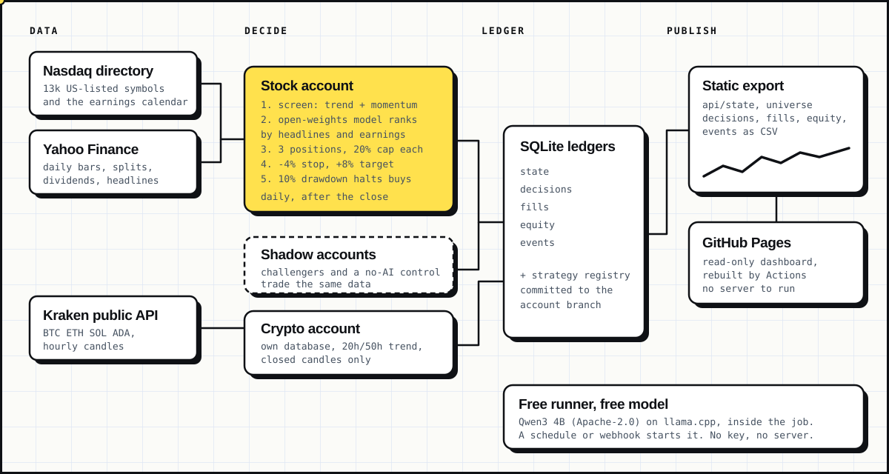
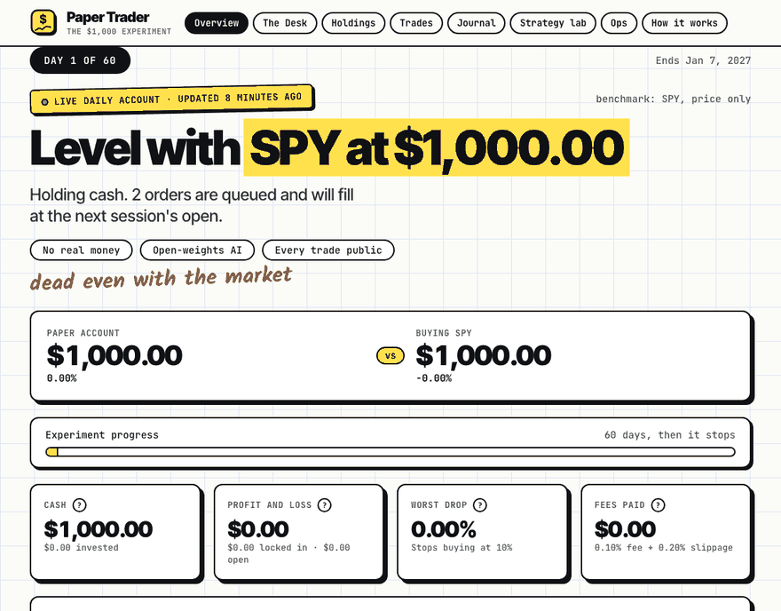
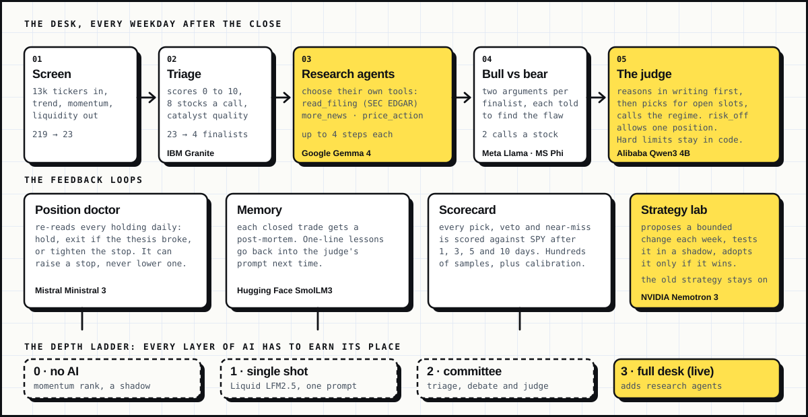
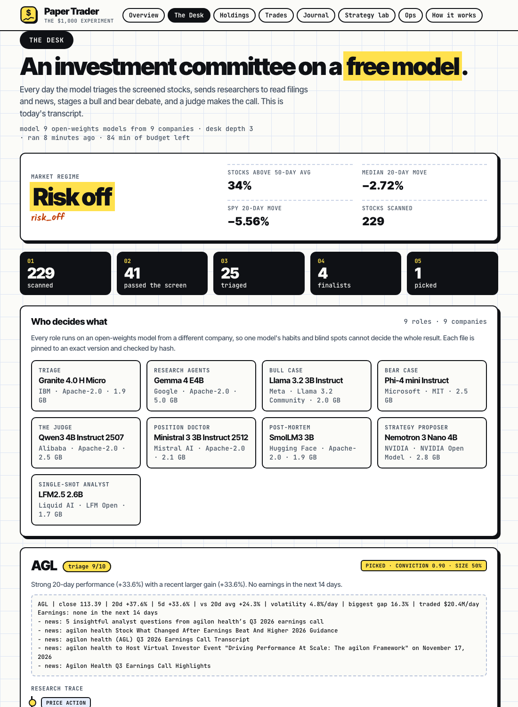
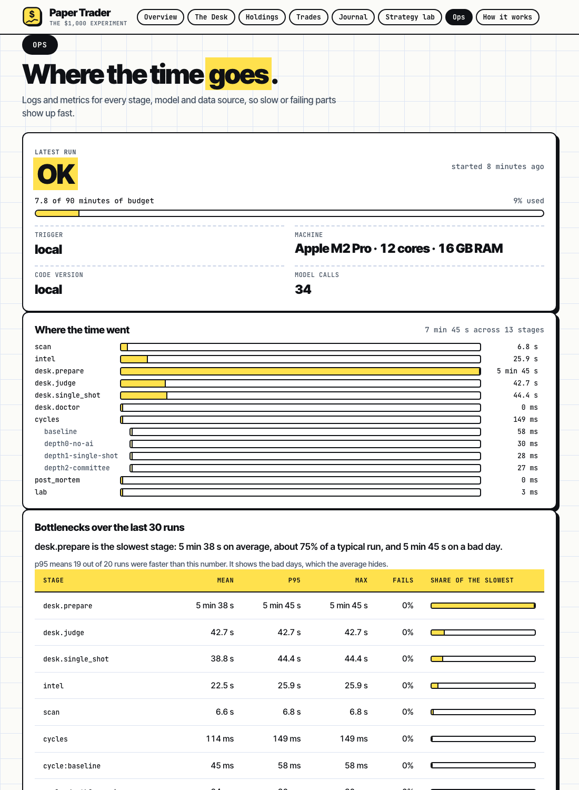

<div align="center">


**A $1,000 paper-trading account run by an investment committee of nine open-weights models from nine different companies. They research with tools, argue with each other, remember their mistakes and grade every call, on free GitHub runners with no API key.**

[](https://mansoor-mamnoon.github.io/paper-trader/)
[](https://github.com/mansoor-mamnoon/paper-trader/actions/workflows/rust.yml)


[Live dashboard](https://mansoor-mamnoon.github.io/paper-trader/) · [The desk](#the-desk) · [Independent models](#independent-models) · [Deterministic runs](#deterministic-runs) · [Logs and metrics](#logs-and-metrics) · [Free and reliable](#free-and-reliable) · [Run it](#run-it) · [Limits](#limits)

</div>

---

<div align="center">

</div>

## What it is

Paper Trader starts with $1,000 of simulated money and looks at US stocks once a day. A quantitative screen finds stocks in an uptrend. Then a desk of small open-weights language models decides which of them to buy. Every signal, every skipped stock, every argument, every model call and every fill goes into SQLite, and a read-only dashboard on GitHub Pages shows all of it.

The question is whether this beats buying SPY after fees and slippage over 60 days, and which parts of the AI deserve the credit if it does. It places no real orders and has no broker connection. It runs on GitHub's free runners with no API key, and the backend is Rust.

<div align="center">

<br><sub>A real run from 8 November 2026. No trades have closed yet, so the portfolio tabs are still empty.</sub>
</div>

| Setting | Value |
|---|---|
| Starting capital | $1,000, long only, fractional shares, fully invested across five slots |
| Universe | US exchange-listed symbols from the Nasdaq directory, ETFs included |
| Schedule | Weekdays at 22:37 UTC, after the US close, with two backups and a watchdog |
| Costs | 0.10% fee per side and 0.20% slippage against each fill |
| Benchmark | SPY, price only |
| Models | Nine open-weights models, one per decision role, 4-bit, on llama.cpp |
| Hosting | GitHub Actions and GitHub Pages |

## The desk

One prompt that asks a small model to rank a dozen headlines wastes most of what a language model can do. GitHub's free runners give the job hours of CPU, so the desk spends that on deliberation.

<div align="center">

</div>

1. **Screen.** About 13,000 tickers go in, and the stocks in a liquid uptrend come out.
2. **Triage.** A model scores the survivors from 0 to 10 for catalyst quality, eight at a time, and the best few become finalists.
3. **Research agents.** Each finalist gets its own research loop. The agent picks its next tool: read the start of an SEC filing, pull older headlines, or inspect the last 15 sessions. It stops when it knows enough or after four steps, and it cannot repeat a call.
4. **Bull and bear.** Two arguments per finalist, one told to make the case for buying and one told to find the flaw.
5. **The judge.** The portfolio manager writes its reasoning first, then picks stocks for the open slots (every slot is the same size) and calls the market regime from breadth and trend. A risk-off call allows one new position at half size. Choosing nothing is a valid answer.
6. **Position doctor.** Every day it re-reads each holding against the news since entry and answers hold, exit, or tighten the stop. It can raise a stop and never lower one.
7. **Memory.** When a trade closes, a post-mortem writes a one-sentence lesson. The latest lessons go into the judge's prompt.
8. **Scorecard.** Every pick, veto and near-miss is scored against SPY after 1, 3, 5 and 10 trading days. That gives hundreds of samples where three trades give none, plus a calibration curve of conviction against outcome. The judge reads its own track record.

Replies are constrained to JSON schemas with length limits, so a small model cannot return malformed or runaway answers. Text from news and filings is treated as untrusted data. Position size, the five-slot cap, costs, the 60-day end and the direction of stop changes are written in code, and nothing a model says can change them. Every stage has a wall-clock budget and falls back to the stage before it when it fails or runs out of time.

<div align="center">

<br><sub>The Desk tab from a real run: a risk-off call, the funnel, and one finalist's research trace.</sub>
</div>

## Independent models

One model making every decision would bring its habits and blind spots to every stage. So each decision role runs on a model from a different company, and a unit test fails if two roles ever share a company.

| Role | Model | Company | License | Size |
|---|---|---|---|---|
| Triage | Granite 4.0 H Micro | IBM | Apache-2.0 | 1.9 GB |
| Research agents | Gemma 4 E4B | Google | Apache-2.0 | 5.0 GB |
| Bull case | Llama 3.2 3B Instruct | Meta | Llama 3.2 Community | 2.0 GB |
| Bear case | Phi-4 mini Instruct | Microsoft | MIT | 2.5 GB |
| Judge | Qwen3 4B Instruct 2507 | Alibaba | Apache-2.0 | 2.5 GB |
| Position doctor | Ministral 3 3B Instruct | Mistral AI | Apache-2.0 | 2.1 GB |
| Post-mortems | SmolLM3 3B | Hugging Face | Apache-2.0 | 1.9 GB |
| Strategy proposals | Nemotron 3 Nano 4B | NVIDIA | NVIDIA Open Model | 2.8 GB |
| Single-shot ablation | LFM2.5 2.6B | Liquid AI | LFM Open | 1.7 GB |

The runner has 16 GB of RAM and 14 GB of disk, which fits one model at a time. A pool in Rust starts one `llama-server`, and when a role needs a different model it downloads that file, stops the old server and starts the next. The desk runs its work in blocks, one model per block, so a full day needs about a dozen swaps.

## Deterministic runs

The same prompt on the same weights should give the same answer, and a reader should be able to check that it did.

- **Greedy decoding.** Temperature 0, `top_k` 1, a fixed seed and no prompt cache on every request.
- **Pinned weights.** Each model file is fetched from an exact Hugging Face commit and its SHA-256 is checked as it downloads. A mismatch deletes the file and fails the load.
- **Pinned runtime.** llama.cpp build `b12211`, with four CPU threads fixed per machine.
- **A canary on every load.** Each model answers the same small prompt twice. If the two answers differ, the run records `UNSTABLE`. The answer hash is stored, so a change in the same model's hash from one day to the next shows up on the Ops tab.
- **Every call is hashed.** The prompt and the output each get a 64-bit hash in the call log, so a call can be replayed and compared.

GitHub's runners are not all the same machine. The CPU model is recorded with every run, so a hash that moves when the CPU changes is explained rather than mysterious.

## Does the AI help?

Most AI trading demos never test that. Here the live account sits at the top of a depth ladder, and a shadow account trades the same data one rung down at every level:

| Depth | What runs |
|---|---|
| 0 | No AI. The same screen ranked by 20-day gain. |
| 1 | One prompt ranks the headlines. |
| 2 | The committee: triage, bull and bear, judge. |
| 3 | The full desk, with research agents and filings. |

The dashboard compares them by portfolio return and by scorecard. If a lower rung wins by a clear margin over two weeks, the strategy lab promotes it, so the system switches off AI that does not pay for itself. The default screen is a plain trend filter with no proven edge, so a good result at depth 0 is also a finding.

## Strategy

The screen is the starting point and the strategy lab can change its values within fixed bounds. The defaults:

- price of at least $5
- 20-day average dollar volume of at least $1M
- close above the 20-day average, with the 20-day average above the 50-day average
- 20-day return above 2%
- no earnings report inside the blackout window (off by default)

Up to 25 survivors reach triage. Five positions at most, each capped at 20% of equity, so a full book is 100% invested and shares are fractional. The judge picks which stocks; it does not size them (a risk-off call halves a position and allows one new entry). A close at or below the stop (-4% by default) or at or above the target (+8%) queues a sell for the next session. A buy never fills at the price that triggered it: it queues and fills at a later open with fees and slippage. There is no loss halt: the drawdown is reported on the dashboard but the account keeps trading, and the experiment ends after 60 days.

### Strategy lab

The loop follows the recursive self-improvement pattern of the [KISS `rsi7d` agent](https://github.com/ksenxx/kiss_ai/tree/main/src/kiss/agents/seas/rsi7d): mine recent runs for evidence, propose a bounded edit, test it, and keep it only if the evidence supports it. Here the edit target is the strategy and the test is a live shadow account.

1. Once a week the system reviews how the live strategy traded and how its picks scored.
2. The proposer model suggests one small change: numeric parameters inside fixed bounds, or the text of the judge's playbook. Anything out of bounds is rejected and logged.
3. The change trades a separate $1,000 shadow account on the same daily data.
4. After 14 days a challenger replaces the live strategy only if it beats it by at least one percentage point with at least two trades and a drawdown no more than three points worse.
5. The replaced strategy keeps trading as a shadow. If the promotion was luck, it wins the seat back under the same rule.

The registry, the lessons, the telemetry and every shadow ledger are committed to the `account` branch, so each change and its evidence stay public.

## Logs and metrics

Every run writes to one SQLite file, `telemetry.sqlite`, and the dashboard's **Ops** tab reads it. It answers three questions at three levels.

| Level | What it shows |
|---|---|
| Run | Status (ok, degraded, failed), minutes used against the budget, trigger, CPU, cores and RAM, and a history of the last 30 runs. |
| Stage | A waterfall of where the time went (scan, intel, filings, each desk block, each strategy's cycle, post-mortems, the lab), and a bottleneck table of mean, p95 and worst time per stage over 30 runs. |
| Call | Per model and per role: calls, success rate, latency, tokens per second for prompt and generation, errors, and the determinism check. Data sources get the same treatment: requests, failure rate and latency for Nasdaq, Yahoo, SEC EDGAR, the earnings calendar and Hugging Face. |

Raw tables download as `runs.csv`, `stages.csv`, `llm_calls.csv`, `events.csv` and `fetches.csv`. Each Actions run also writes the same report to its job summary, so a run can be judged from the Actions page without opening the site. Prompts and outputs are stored as hashes plus the first 300 characters of any error, which keeps the file small enough to commit daily.

## Free and reliable

The question was whether a free GitHub account can run this every day. For a public repository it can.

| Question | Answer |
|---|---|
| Cost | Standard GitHub-hosted runners are free and unlimited in public repositories. Private repositories on the free plan get 2,000 minutes a month on smaller machines. |
| Machine | `ubuntu-latest` in a public repository is 4 vCPU, 16 GB RAM and 14 GB of disk. A private repository gets 2 vCPU and 8 GB. |
| Job length | Up to 6 hours. A full desk run is well inside that. |
| Schedule precision | Cron runs can start late when GitHub is busy, and a run can be dropped without an error. |
| Inactivity | GitHub disables scheduled workflows in a public repository after 60 days without activity. |

The two weak points are the last two, so the repository handles both. The account job is scheduled three times a day, and it skips itself when the account already ran in the last 16 hours, so the backups cost nothing when the first run worked. A separate watchdog checks every weekday morning that a run happened after the previous US session and starts one if it did not. Every run and the watchdog re-enable the schedules, which resets the inactivity clock. A webhook (`repository_dispatch` with event type `run-account`) can also start a run from outside.

I also looked at other free routes: an always-free cloud VM, free Hugging Face Spaces, Kaggle scheduled notebooks, and free hosted inference. Each needs an account, a card or a token set up by hand, sleeps when idle, or is hosted rather than local. None beats a runner that already sits next to the repository, so everything stays on Actions. Sources: GitHub's pages on [runner hardware](https://docs.github.com/en/actions/reference/runners/github-hosted-runners) and on [disabling and enabling workflows](https://docs.github.com/en/actions/how-tos/manage-workflow-runs/disable-and-enable-workflows).

On a real runner the full desk, with all nine models, nine swaps and four strategies, took 28 minutes with nothing skipped, against 7 minutes on an Apple M2 Pro. The runner had 88 GB of disk free, so pruning each model file after use is a safety margin and not a need. If the model server fails to start, the account still trades by momentum ranking and the dashboard says so. The `Model smoke test` workflow runs the whole desk on a scratch account to check timing, disk and determinism on a real runner without touching the live ledger.

## Dashboard

<div align="center">

<br><sub>The Ops tab from a real run on a Mac: stage waterfall, models and data sources.</sub>
</div>

Eight tabs. Overview opens with a one-line verdict against SPY and a 60-day progress bar. The Desk shows today's committee transcript and which model decided each part: regime, funnel, each finalist's research trace and debate, the judge's reasoning, the doctor's notes and the lessons in memory. Holdings shows each stock's price between its stop and its target. Trades lists every fill. Journal explains each decision in plain English with a ticker search. Strategy lab shows the live strategy, the challengers, the depth ladder and the calibration chart. Ops covers performance and bottlenecks. How it works covers the rules and the limits.

Full histories download as `decisions.csv`, `fills.csv`, `equity.csv` and `events.csv`, and `api/state` returns the raw snapshot.

## Crypto account

A second $1,000 account trades BTC, ETH, SOL and ADA from public Kraken data, in its own database.

- Signal: the 20-hour average of closed hourly candles above the 50-hour average, with 24-hour momentum above 1%
- Orders queue on one observation and fill on a later fresh one, at the ask plus 0.10% slippage and a 0.40% fee
- Sizing: at most 25% of equity per position, about 1% of equity at risk per trade and 3% in total
- Exits: -4% stop, +8% target, a seven-day holding limit, or a trend break

```bash
paper-trader crypto once   --db crypto.sqlite    # observe Kraken and apply one cycle
paper-trader crypto replay --db replay.sqlite --input snapshots.json
paper-trader crypto status --db crypto.sqlite
```

## Run it

You need a stable Rust toolchain, 1.88 or newer, and about 25 GB of disk if you keep all nine models.

```bash
git clone https://github.com/mansoor-mamnoon/paper-trader.git
cd paper-trader

# The Rust binary downloads, verifies and swaps the pinned models itself.
export PAPER_TRADER_LLAMA_SERVER=$(scripts/llm.sh install)
export PAPER_TRADER_MODELS_DIR=$HOME/.cache/paper-trader-llm/models
cargo run --release -- stocks --db account.sqlite --output site

cp web/* site/        # the dashboard; serve site/ with any static file server
```

To check every model on a new machine, run `cargo run --release --example pool_check`. It loads each role's model, asks it a small question under a JSON schema, and prints load time, speed and the determinism check.

Without `PAPER_TRADER_LLAMA_SERVER` the account trades by momentum ranking. A single OpenAI-compatible server (Ollama, LM Studio, vLLM) works through `PAPER_TRADER_LLM_URL`, and a paid model through `ANTHROPIC_API_KEY`. Both use one model for every role.

| Setting | Meaning |
|---|---|
| `--batch-size N` | Symbols per run. 20000 covers the full directory with many requests. |
| `--replay FILE` | Apply a saved observation to a separate account. |
| `--strategies DIR` | Where the registry, shadow ledgers and telemetry live. Defaults to next to `--db`. |
| `PAPER_TRADER_DESK_MINUTES` | Wall-clock budget for all model calls in a run. Default 120. |
| `PAPER_TRADER_PRUNE_MODELS` | Delete each model file after the pool moves on, to bound disk use. |
| `PAPER_TRADER_SKIP_WITHIN_HOURS` | Do nothing if the account already ran this recently. |
| `PAPER_TRADER_SEC_CONTACT` | An email address for SEC requests. SEC filings stay off without one. |

To host your own copy, fork the repo and create an `account` branch containing an initialised `account.sqlite` and an `INITIALIZED` file. Enable GitHub Pages with the Actions source and the workflows take over.

```
src/
  main.rs       command line, run metadata, skip guard
  daily.rs      one daily run: blocks of model calls, shadows, memory, the lab
  desk.rs       triage, research agents, debate, judge, doctor, post-mortems
  models.rs     the nine pinned models and which role each plays
  pool.rs       downloads, verifies, swaps and canary-checks model servers
  telemetry.rs  runs, stages, model calls, data fetches and events
  scorecard.rs  forward returns of every pick, veto and near-miss
  account.rs    screen, queued orders, sizing, fills, risk limits
  analyst.rs    model clients and the single-shot analyst
  edgar.rs      SEC filings and filing text
  intel.rs      earnings calendar and headlines
  strategy.rs   the bounded, editable strategy
  lab.rs        shadow accounts, promotion rule, proposals
  data.rs       Nasdaq directory and Yahoo daily bars
  crypto.rs     crypto account and Kraken data
  ledger.rs     SQLite schema, state and reports
  export.rs     JSON and CSV snapshot
web/            the dashboard (plain HTML, CSS and JavaScript)
scripts/        llm.sh installs llama.cpp
examples/       pool_check and edgar_live diagnostics
docs/           README images
.github/        scheduled run, watchdog, model smoke test and CI
```

The crate is a library plus a thin binary on edition 2024 with 80 unit tests, and it passes `cargo clippy -- -D warnings` with the pedantic group enabled. Backend code is Rust only.

## Limits

- Sixty days is too short to separate skill from luck, so a good or bad result says little about the rules. The scorecard exists to get more samples, not to remove this limit.
- Models of 2 to 5 billion parameters are weak readers of financial news. The depth ladder measures whether they add anything.
- Determinism holds on one machine. Across runners with different CPUs, floating-point differences can change a token, which the CPU field and the canary hash are there to expose.
- SEC filings are off until you set `PAPER_TRADER_SEC_CONTACT` (a repository variable named `SEC_CONTACT` in Actions) to a real email address. The SEC's servers refuse requests that do not identify their owner, and the project does not invent a contact for you. Without it the desk works from headlines and says so in the transcript.
- Prices come from a free Yahoo endpoint with no guarantees. Missing quotes are logged and the symbol is skipped.
- Stops and targets are checked on daily closes, so a gap can lose more than the stop level.
- Execution is simplified. Liquidity, queue priority, outages and market impact are not modeled.
- GitHub schedules can run late or fail. The backups and the watchdog make a missed day unlikely, and the last good snapshot stays online until the next run succeeds.

This is a simulation and not financial advice.

If you find it interesting, a star helps other people find it. Issues and critiques of the strategy are welcome.
