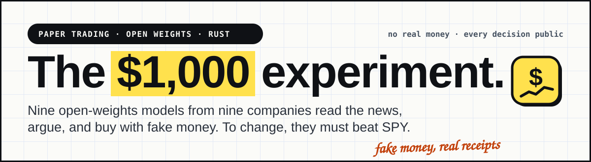
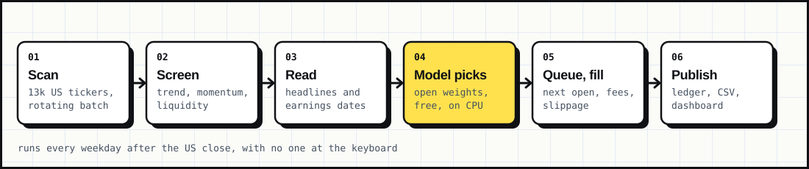
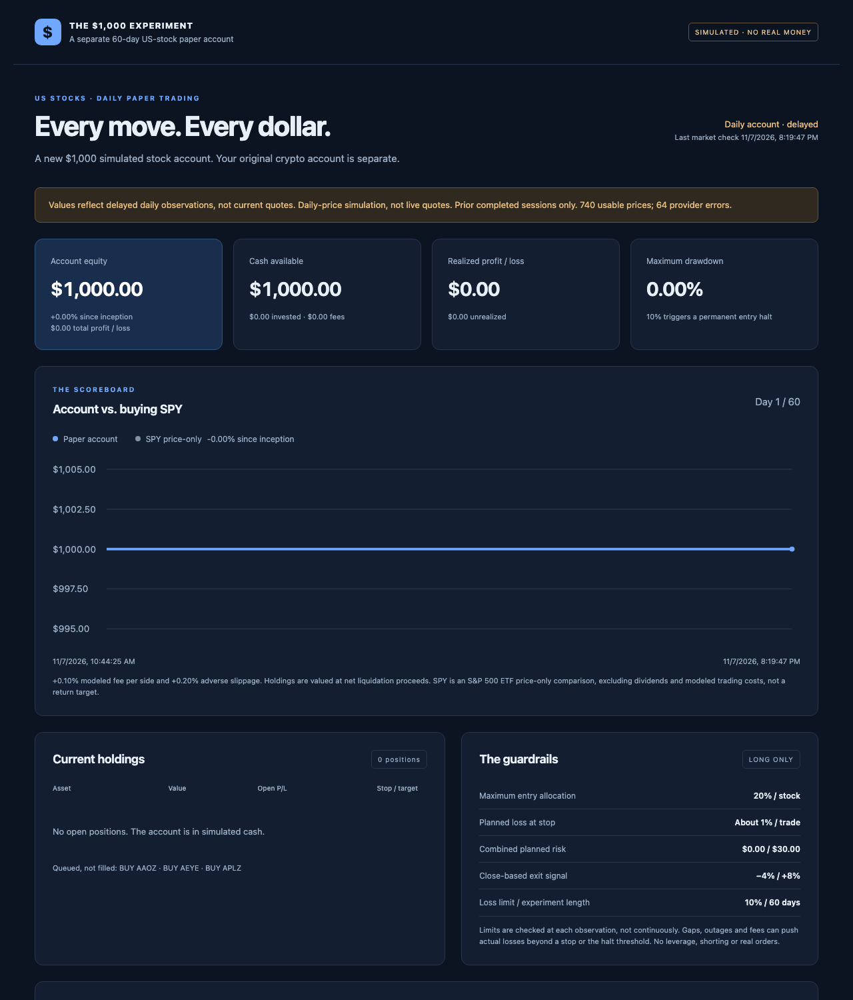

<div align="center">



**A $1,000 simulated US-stock account that trades by fixed rules and publishes every decision.**

[](https://mansoor-mamnoon.github.io/paper-trader/)


[**Live dashboard**](https://mansoor-mamnoon.github.io/paper-trader/) · [How it works](#how-it-works) · [Strategy](#the-strategy) · [Run it yourself](#run-it-yourself) · [Limits](#what-this-does-not-tell-you)

</div>

---

## Demo

<div align="center">

<br><sub>The real dashboard, captured from the live site. Starting state: $1,000, no positions yet.</sub>
</div>

Paper Trader starts with **$1,000 of fake money**, looks at US stocks once a day, and buys or sells according to a small, fixed rulebook. Nothing is hidden. Every signal, every skipped stock and every fill is written to a ledger, and the whole ledger is published on a read-only dashboard.

The question it tries to answer is simple: **does a plain, rules-based approach beat just buying SPY, after realistic costs?** It makes no claim that it does.

| | |
|---|---|
| **Account** | $1,000 simulated, long-only, whole shares |
| **Universe** | US exchange-listed symbols from the Nasdaq directory, including ETFs |
| **Cadence** | Once a day, after the US session (22:37 UTC, Mon–Fri) |
| **Costs modeled** | 0.10% fee per side and 0.20% adverse slippage |
| **Benchmark** | SPY, price-only |
| **Runs on** | GitHub Actions + GitHub Pages. No server, no broker |

## How it works

<div align="center">

</div>

1. **Universe.** The worker downloads the free Nasdaq symbol directory and drops test issues.
2. **Daily bars.** It pulls delayed daily candles (Yahoo Finance's unofficial endpoint) for a rotating batch of symbols, 800 per run by default, so coverage cycles through the whole market over time.
3. **Signals.** Each symbol is checked against the rules below. The result is logged as `CANDIDATE` or `PASS`, along with the numbers that led to it.
4. **Queue.** A buy or sell signal never fills at the price that triggered it. It is queued for a **later completed session**.
5. **Fill.** The order executes at that session's open, worsened by slippage and a fee, in whole shares.
6. **Publish.** The account is exported as JSON and CSV, and the static dashboard is redeployed to GitHub Pages.

The durable account lives in SQLite on a dedicated `account` branch. The scheduled workflow restores it, checks `PRAGMA integrity_check`, and treats a missing database as an error rather than a reset.

## The strategy

Deterministic. No LLM picks trades.

**Entry** needs all of:

- price of at least **$5**
- average dollar volume of at least **$1M/day** (20-day)
- close above the **20-day average**, which is above the **50-day average**
- **20-day momentum above 2%**

Candidates are ranked by momentum, and the best fill up to **3 slots**.

**Sizing:** at most **20%** of equity per stock, rounded down to whole shares.

**Exit:** a close at or below **−4%** (stop) or at or above **+8%** (target) queues a sell for the next session.

**Account kill-switch:** a **10% drawdown** permanently halts new entries and queues exits.

## The dashboard

<div align="center">

</div>

- **Scoreboard:** account equity against buying SPY.
- **Current holdings** with stop and target levels, plus any queued orders.
- **Decision journal:** the latest 120 decisions with their evidence.
- **Executed trades:** the latest 200 fills with fees and closed P/L.
- **System activity and coverage:** how many symbols had usable prices and how many provider errors occurred.
- **Downloads:** full `decisions.csv`, `fills.csv`, `equity.csv`, `events.csv`, plus `api/state` and `api/universe.json`.

## Run it yourself

Python 3.12, standard library only.

```bash
git clone https://github.com/mansoor-mamnoon/paper-trader.git
cd paper-trader

# One daily observation against a local account database
python -m projects.paper_trader.stocks --db account.sqlite --output site

# Then open site/ with any static file server
python -m http.server --directory site 8000
```

Useful flags:

| Flag | Meaning |
|---|---|
| `--batch-size N` | Symbols per run (default 800; 20000 covers the whole directory but makes many requests) |
| `--replay FILE` | Replay explicit observations into a separate account |

To host your own copy, fork the repo, create an `account` branch holding an initialised `account.sqlite` and an `INITIALIZED` marker, enable GitHub Pages with the Actions source, and the included workflow takes it from there.

## Repository layout

```
.github/workflows/account.yml   Scheduled run: restore account, trade, export, deploy
projects/paper_trader/
  stocks.py        Entry point: run one cycle, export JSON and CSV
  stock_account.py Signals, queued orders, fills, risk limits
  stock_data.py    Symbol directory and daily bar fetching
  ledger.py        SQLite ledger
  stock_static/    The dashboard (plain HTML, CSS, JS)
app/projects/paper_trader/      Earlier local crypto-account version with its own server
docs/                           README assets
```

## What this does not tell you

- **No edge is claimed.** A short run proves nothing. Results can be luck.
- **Delayed, unofficial data.** Prices come from a free endpoint with no guarantees. Missing quotes are logged, not guessed.
- **Daily bars only.** Stops and targets are checked at the close, so real gaps could cost more than the model shows.
- **Simplified execution.** Real liquidity, queue priority, outages and market impact are not modeled.
- **Schedules can slip.** GitHub provides no uptime guarantee. The last good snapshot stays up if a run fails.

This is a simulation and a public experiment. It is not financial advice and it places no real orders.

## Contributing

Ideas, bug reports and strategy critiques are welcome. Open an issue. If the project is useful or interesting to you, a ⭐ helps others find it.
