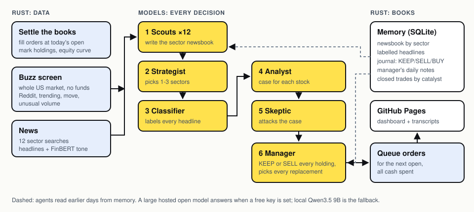

<div align="center">


# Paper Trader

A $1,000 simulated account run by DeepSeek V4.1 Flash through NVIDIA’s free hosted API, with a local model available as a fallback. They trade news buzz sector by sector, decide every holding every day, and publish every decision.

[Dashboard](https://mansoor-mamnoon.github.io/paper-trader/) · [Ops](https://mansoor-mamnoon.github.io/paper-trader/#ops) · [Actions](https://github.com/mansoor-mamnoon/paper-trader/actions)
</div>

## What happens each evening



After the US close, a GitHub Actions run does one trading day:

1. **Settle.** Rust fills yesterday's orders at today's open, with a 0.1% fee and 0.2% adverse slippage on each side, and marks the book.
2. **Buzz screen.** It reads the entire US market from the Nasdaq screener in one request. It keeps companies worth at least $5B, priced at least $3 and trading at least $25M a day, and drops every ETF, index fund, closed-end fund, ETN, preferred, warrant and unit. It scores each stock by attention: Reddit mentions and their growth, Yahoo and StockTwits trending lists, the size of the day's move, dollar volume, and volume against its 20-day average. The screen decides what the models read. It never decides a trade.
3. **FinBERT** reads every fresh headline of the 60 screened stocks and the holdings and scores its tone from -1 to +1. It runs in Rust in a few seconds. Good news lifts a stock in the screen, bad news lowers it, and each agent sees the score beside every headline.
4. **Scouts** (one per sector, 12 sectors) each write the day's newsbook entry from two days of sector news, the sector's tape, its most-buzzed stocks and their own earlier entries.
5. **Strategist** reads the newsbook and picks one to three sectors to trade. The candidates are the eight most-buzzed stocks in those sectors, from the whole eligible market, plus the four most-buzzed stocks anywhere else.
6. **Classifier** labels every headline of every holding and candidate (product launch, big deal, results beat, upgrade, approval, policy, takeover, retail frenzy, demand boom, bad news, noise, unrelated) with a buzz score from 0 to 3. CEO changes, filings, dividends and conference appearances are noise by definition.
7. **Analyst** makes the case for each holding and each candidate, and must name the one headline the case rests on. A case that cites no headline, or cites one labelled noise, unrelated or bad news, does not count, so the stock cannot be bought on it. Only a sector-wide catalyst may rest on the newsbook instead. **Skeptic** only argues against it, with the same file: is it fresh, is it priced in, is the buzz fading. If the analyst found no catalyst, the skeptic agrees and says why to avoid the stock; it never makes the bull case itself.
8. **Manager** must answer KEEP or SELL for every holding. Every sale must be replaced: it picks the replacements and their weights from the candidates the analyst made a case for. A replacement must clearly beat what it replaces after the 0.6% round-trip cost. It reads its own notes, decisions and closed trades from earlier days.
9. **Rust queues the orders** for the next open, writes everything to memory and publishes the dashboard.

Independent research runs concurrently: the 12 scouts, headline-classification batches, and debates for different stocks share a bounded worker pool. Each skeptic waits for its own analyst; the strategist waits for the scouts, and the manager waits for all research. SQLite writes stay on the main thread, and results retain their original order. Local fallback inference is serialized so concurrent calls cannot swap its model or overload the single local server.

## Rules no model can change

- Always fully invested in at most eight individual US stocks. Sales fill before purchases, and purchases share all the cash by weight. If the manager sells and buys nothing new, the freed cash tops up the stocks it kept.
- No purchase may take a stock above 25% of the account. What a capped purchase cannot take goes to the other purchases.
- No minimum holding period. The manager can replace any holding, including one bought at the latest open, when the evidence supports the swap after its roughly 0.6% round-trip cost.
- Only a stock the analyst made a case for can be bought. A clear sector driver that lifts the company, such as oil prices for an oil producer, counts as a case, and so do earnings beats.
- The book never drops below four stocks, so the money always fits under the 25% cap. If too few candidates have a case to replace the day's sales, the manager chooses which sales to call off. Cash a capped purchase cannot take is spread over the other holdings at the same open.
- No stop-losses, take-profit rules or momentum fallback. A model decides every holding and every purchase. If no model runs, the books are settled and nothing is traded.
- Earnings dates are not a filter. Nothing stops the desk from holding through a report.
- Each answer must match a JSON schema enforced by the model server. A holding can only get KEEP or SELL, a purchase can only be a stock the analyst argued that day, and a focus sector can only be one the scouts wrote about.

## Memory

Everything lives in one SQLite file on the `account` branch:

| Table | What the agents get from it |
|---|---|
| `newsbook` | Each scout reads its sector's last five entries, so a bill moving through Congress or a spending wave is followed across days |
| `headlines` | Headlines are stored with the day the desk first saw them and the classifier's label, so old news is shown as old |
| `journal` | The manager reads its last five notes, the last week of KEEP, SELL and BUY decisions, and every past decision on a holding |
| `trades` | The manager reads recent closed trades and the account's average return by catalyst |
| `calls` | Every prompt and answer, kept ten days and published per day on the dashboard |

## Models

The desk uses three kinds of model, each for what it is good at.

**DeepSeek V4.1 Flash makes the decisions.** All six agent roles use `deepseek-ai/deepseek-v4.1-flash` through NVIDIA's OpenAI-compatible endpoint. The repository is configured with `PAPER_TRADER_API_KEY` in GitHub Actions secrets, and the URL and model in repository variables. The key is never exported to the dashboard or committed. A live authenticated request succeeded on 14 November 2026.

```sh
# For a separate installation; never put the key in source code.
gh secret set PAPER_TRADER_API_KEY
gh variable set PAPER_TRADER_API_URL --body https://integrate.api.nvidia.com/v1
gh variable set PAPER_TRADER_API_MODEL --body deepseek-ai/deepseek-v4.1-flash
```

`PAPER_TRADER_API_RPM` and `PAPER_TRADER_API_TPM` set the requests and tokens allowed per minute (defaults 20 and 60,000). Workers reserve request and token quota under one shared limiter before sending, including the full output budget. The client paces requests, retries transient failures and validates each answer against its JSON schema. The client requests chat mode using DeepSeek’s documented `thinking_mode="chat"` and `enable_thinking=false` template settings, leaving the 2,500-token output budget for the structured answer. Returned reasoning-token counts and reasoning-content length are logged when available. The dashboard records the model that actually answered each question.

[NVIDIA documents free endpoint access for prototyping](https://docs.api.nvidia.com/nim/docs/run-anywhere); provider availability, limits and terms can change. There is no paid API fallback or automatic purchase of credits. An unavailable endpoint falls back to the local model on the free public GitHub runner.

`PAPER_TRADER_WORKERS` controls concurrent model tasks (safe default 1, range 1–32). The request/token limits remain shared across every worker and retry. More workers may hide provider latency, but do not bypass quotas or guarantee a proportional speedup. `PAPER_TRADER_API_TIMEOUT_SECONDS` sets each hosted request's timeout (default 900 seconds, range 1–3,600), with the existing retries and local fallback after persistent failures.

The manual **Measure concurrency and replay** workflow measures 1, 2, and 4 workers, then repeats the 1-worker baseline to expose changing provider conditions. Each round uses the same four known-answer desk questions and the production Rust client, with a 180-second request timeout, no retries and no local fallback. A level is eligible only when all four answers are correct; higher concurrency must improve correct answers per minute by at least 15%. The last measurement of a level is used. This is a small operational sample, not a permanent provider-capacity guarantee or a test of trading profitability.

The optional `timeout_seconds` workflow input accepts 180, 600, or 900 seconds per request; the default is 180. A failed short-deadline round proves that no level met that deadline, not that requests can never complete. The benchmark also captures NVIDIA’s public model queue with a timestamp as supporting context, without assuming it gives an exact wait time for our API requests.

The workflow preserves the measurements as the `concurrency-measurements` artifact and dispatches Thursday→Friday replay automatically with its measured worker count. If no level passes, it records the failure and does not start another unverified replay. The measurement job itself directly dispatches follow-up measurements with 600 seconds, then 900 seconds per request, stopping at the first usable result or after the longest deadline fails. It has no schedule and does not retry indefinitely. The previous eight-worker replay stalled, so eight workers are no longer assumed to be faster. Normal runs use the conservative repository setting until a measured selection is applied.

```sh
# Measure on GitHub and automatically launch a replay only after a usable result.
gh workflow run tune.yml --ref main
# Or measure locally with PAPER_TRADER_API_KEY in the environment:
./target/release/paper-trader tune --levels 1,2,4,1 --samples 4 --timeout 180 --output concurrency.json
```

An earlier `thinking: false` template argument was replaced with the documented chat-mode settings before remeasurement; the old flag was not evidence that reasoning was disabled. See the [published DeepSeek template](https://huggingface.co/deepseek-ai/DeepSeek-V4.1-Flash/blob/main/chat_template.jinja).

Measured on 15 November 2026 UTC, using the corrected chat-mode request ([run](https://github.com/mansoor-mamnoon/paper-trader/actions/runs/43666102619), [raw measurements](docs/concurrency-2026-11-15-180s.json)):

| Workers | Correct / attempted | Round time |
|---|---:|---:|
| 1, initial baseline | 0 / 4 | 724.2 s |
| 2 | 0 / 4 | 360.4 s |
| 4 | 0 / 4 | 180.2 s |
| 1, repeated baseline | 0 / 4 | 720.9 s |

All 16 requests ended in a transport timeout, with no complete response inside the 180-second request deadline. No worker count qualified. This is evidence of poor responsiveness even at one worker, not proof that longer requests cannot complete. The same workflow tests longer deadlines before selecting a setting and starting the replay. NVIDIA’s [public model queue](https://buildapi.ngc.nvidia.com/v2/predict/queues/models/qc69jvmznzxy/deepseek-v4.1-flash) reported roughly 1,600 pending requests during the test; that is supporting congestion context, not our exact position or wait time.

The 600-second follow-up also failed to qualify a level ([run](https://github.com/mansoor-mamnoon/paper-trader/actions/runs/43668904595), [raw measurements](docs/concurrency-2026-11-15-600s.json)):

| Workers | Correct / attempted | Round time |
|---|---:|---:|
| 1, initial baseline | 2 / 4 | 1175.2 s |
| 2 | 1 / 4 | 569.0 s |
| 4 | 0 / 4 | 192.8 s |
| 1, repeated baseline | 0 / 4 | 1208.6 s |

Only 3 of 16 requests succeeded. The other 13 returned provider HTTP 500 or 504 errors; most gateway timeouts arrived after about 302 seconds despite the longer client deadline. No Thursday→Friday replay was dispatched from these results, and the live account was not replaced. The original continuation callback did not launch the promised 900-second follow-up; the callback dependency has been removed, and the measurement job now directly dispatches its bounded follow-ups.

Each hosted question now has a request ID linked to its agent and stock/sector. Progress logs report quota wait, request start, HTTP status and elapsed time, transport failures, and each retry. A heartbeat alone indicates an active task, not a completed answer.

The desk defaults to `--minutes 0`: research every candidate without the previous early time cutoff. A positive value opts into a finite research budget. Daily and replay jobs allow the GitHub-hosted maximum of six hours per job; the desk step has 345 minutes, leaving time to preserve evidence and publish. Thursday and Friday have separate job allowances. These are platform limits, not unlimited execution. See [GitHub Actions limits](https://docs.github.com/en/actions/reference/limits).

**A local model as the fallback, and the default with no key.** Qwen3.5 9B (Apache-2.0, 4-bit, 5.7 GB) runs with llama.cpp on the runner. Any question the hosted model fails, whether from a rate limit, an outage, or an answer that does not match the required JSON shape, goes to the local model, so decisions can continue without the provider. After three failed questions in a row the hosted model is left alone for the rest of the run. Rust downloads llama.cpp and the model itself, pins each file to a Hugging Face commit and checks its SHA-256.

**FinBERT for tone.** [ProsusAI/finbert](https://huggingface.co/ProsusAI/finbert) (CC BY-NC-SA 4.0) is a 110M-parameter BERT trained on financial text. It runs in pure Rust with [candle](https://github.com/huggingface/candle) and its own WordPiece tokenizer: ten headlines take about a tenth of a second. That speed is its job here. The language model has time to label the headlines of about twenty stocks; FinBERT reads all sixty screened stocks, so news tone can shape which stocks are researched at all. It is a second opinion and not a judge: on test headlines it called an FDA approval neutral and a "fewer customers" story positive, which is why the language model's catalyst label stays and FinBERT's score sits beside it. `paper-trader tone "headline"` prints its reading.

The previous desk used nine 2–4B models, one per role, chosen to come from nine different companies. The new desk drops that rule. One stronger model plays every role, so there are no model swaps during a run and the time goes into more and longer answers. Larger open models were considered:

| Model | Size at 4 bits | Fits the runner | Notes |
|---|---:|---|---|
| Qwen3.5 9B | 5.7 GB | yes | Local fallback. Published reasoning scores (GPQA) above gpt-oss-20b, and it leaves room for a 12k context |
| Gemma 4 12B (QAT) | 7.0 GB | yes | Registered as an alternative to compare |
| gpt-oss-20b | 11.6 GB | barely | Mixture of experts with about 3.6B active parameters, so it is fast on CPU, but 11.6 GB leaves little room for the context in 16 GB |
| Gemma 4 26B-A4B, Qwen3.6 35B-A3B | 13–17 GB | no | Too large for 16 GB |
| Qwen3 4B Instruct (old judge) | 2.5 GB | yes | Kept as the baseline |

`paper-trader bench` puts the same known-answer desk questions to each model, the hosted one first when a key is set: labelling eight headlines, deciding three holdings, and picking two purchases. It reports accuracy and speed. Set `PAPER_TRADER_MODEL=<id>` to run the whole desk on another registered model.

First results, on an Apple M2 Pro (Metal), 13 November 2026:

| Model | Headlines labelled right | Holdings decided right | Purchases right | Generation speed |
|---|---:|---:|---:|---:|
| Qwen3.5 9B | 8 / 8 | 3 / 3 | 2 / 2 | 26 tokens/s |
| Qwen3 4B Instruct | 8 / 8 | 3 / 3 | 2 / 2 | 48 tokens/s |

Both models answered every question correctly, so these questions are too easy to separate them. DeepSeek now handles the open-ended work; the 9B model remains available for fallback. The runner has no GPU, so it is several times slower there. The questions should get harder as the journal collects real cases the desk got wrong.

## Why the desk is built this way

- **Debate, but one round.** [TradingAgents](https://arxiv.org/abs/2412.20138) showed an analyst, debate and manager structure for trading. [Talk Isn't Always Cheap](https://arxiv.org/abs/2509.05396) found that longer debates can move correct answers to wrong ones. So the skeptic gets one rebuttal and the manager decides, with no back-and-forth.
- **Structure matters more than the model.** The live [Agent Market Arena](https://arxiv.org/abs/2510.11695) found that changing the agent structure changed results far more than changing the model. That is why the roles have separate evidence jobs (sector news, headlines, the case, the attack, the book) and not just different personas.
- **News is the signal.** [Lopez-Lira and Tang](https://arxiv.org/abs/2304.07619) found that LLM readings of headlines predict next-day returns, more strongly for smaller stocks. [Beyond Sentiment](https://www.alphaxiv.org/abs/2607.28496) found that structured LLM features add information that sentiment scores miss. That is why the classifier labels the kind of catalyst instead of scoring positive or negative.
- **Two readers of the news.** [Beyond Sentiment](https://www.alphaxiv.org/abs/2607.28496) found that FinBERT sentiment and LLM-extracted features together predict next-day moves better than either alone. So FinBERT scores tone for every screened stock, and the LLM classifier labels the kind of catalyst for the stocks being argued.
- **Why not fine-tune a smaller model from a larger one.** The MIT work in this area ([DisCIPL](https://news.mit.edu/2025/enabling-small-language-models-solve-complex-reasoning-tasks-1212)) has a large model plan and small models execute; distillation more generally needs a teacher and many labelled examples. The desk has no free teacher that can run on the runner and, so far, only a handful of closed trades to learn from. Revisit once the `trades` and `headlines` tables hold a few hundred labelled outcomes: they are exactly the training set a distilled classifier would need.
- **Why the screen is buzz and not momentum.** The previous screen ranked 20- and 50-day trend winners and then the models explained them. Trend alone produced the CEO-change and pool-supply rationales in the old journal. The new screen surfaces what people are talking about today, and the models read the news to decide whether the talk is worth money.

## Ops

The dashboard's Ops tab shows how each run spent its time, so bottlenecks are easy to find:

- every stage of the day, and inside the data stage every source (screener, fund list, buzz sources, daily bars, settling the books)
- each agent's calls, failures, total and slowest time, tokens read and written, and reading and writing speed
- configured model workers and summed model-call time; overlapping calls can sum to more than the run's elapsed time
- the ten slowest model calls
- model runtime events: llama.cpp download, model download and server start times
- every data source's requests, failures, average and slowest latency, and bytes
- the machine, the trigger, the GitHub run and the commit
- trading: fills, dollars bought and sold, fees, turnover and orders queued
- a history table comparing every run, and the run's problems and events

The same numbers are stored in each day's report in the ledger, so trends can be studied later.

## Run locally

```sh
cargo test --locked
cargo build --release --locked
./target/release/paper-trader run --db account.sqlite --output site --force
./target/release/paper-trader bench --models qwen3.5-9b,qwen3-4b-instruct
```

With `PAPER_TRADER_API_KEY` set, DeepSeek answers first and no local runtime is downloaded unless a fallback is needed. Without a key, the first question downloads llama.cpp and the local model (5.7 GB) to `~/.cache/paper-trader-llm`. Public market data and local inference need no paid service. Open `site/index.html` after copying `web/*` into `site/`.

To run the desk on GitHub now instead of waiting for the evening schedule:

```sh
gh workflow run account.yml --ref main -f force=true
```

## Unattended operation

The public repository uses standard GitHub-hosted runners and GitHub Pages. The account workflow runs after the US close at 22:37 UTC, with catch-up triggers at 00:47 and 03:23 UTC. Already completed sessions skip model work. A morning watchdog at 07:17 UTC checks for a missed run and dispatches it; both workflows re-enable their schedules. No computer needs to stay on and no daily manual trigger is needed. The durable SQLite account is committed before publication, including failure evidence.

GitHub cron can be delayed or dropped, and inactive repositories can have schedules disabled. The watchdog reduces missed runs but cannot guarantee service if GitHub disables both schedules or NVIDIA changes its free access. No billing settings or paid services are enabled by this project.

For a deliberate historical rerun, provide the original cutoff. Forced reruns archive the previous database under `archive/rerun-<run-id>/` on the `account` branch. Existing fills and holdings remain; the manager replaces the unfilled order queue with its new decisions. Historical data sources are cut at the cutoff; trending lists are omitted because they have no history.

```sh
gh workflow run account.yml --ref main -f force=true -f as_of=2026-11-14T06:00:46Z
```

## One-off Thursday → Friday replay

The manual-only `replay.yml` workflow rebuilds November 12–13 with DeepSeek and the current rules, including no minimum holding period. It starts from the original November 12 close (account commit `aa1b9e2418744ba67222cf11771ed245c6d0ba24`), preserving the ten actual Thursday holdings and the earlier ledger. It archives the current account before doing any replay work.

Thursday's cutoff is `2026-11-12T22:07:43.379Z`. Its orders fill at Friday's open; Friday then researches and decides at `2026-11-13T22:07:43.379Z` using Thursday's resulting account and memory. The jobs run in sequence with the same account lock as normal daily updates. Friday cannot start until Thursday validates and its checkpoint is committed. Validation checks successful DeepSeek calls, a decision for every holding, and that Friday's new fills came from Thursday's orders. Only a validated Friday result replaces the live account and publishes the dashboard.

Both checkpoints, their decisions and the previous live account are preserved under `archive/deepseek-replay-<run-id>/` on the `account` branch. This workflow has no schedule; subsequent normal runs continue from the replayed account. Historical replay filters future bars and dated headlines, but the current stock universe and the model's own knowledge are not a perfect historical snapshot.

## Switchover

The model desk took the account over on 13 November 2026. The ledger was rewound to the 12 November close, and the new desk ran for that evening with `--as-of`, which cuts every source at that moment: bars end at the 12 November session, headlines must have been published before it, and Reddit counts are the previous day's. Trending lists have no history, so that run went without them. Its orders filled at the real 13 November open. The previous desk's 13 November trades are kept in `archive/` on the `account` branch.

## Limits

This is a paper account: no broker is connected. Daily bars cannot show intraday fills. Headlines come from free feeds and can be late or missing. Five concentrated buzz positions are volatile by design, and a few weeks of results cannot show whether the desk has an edge. Nothing here is investment advice.
