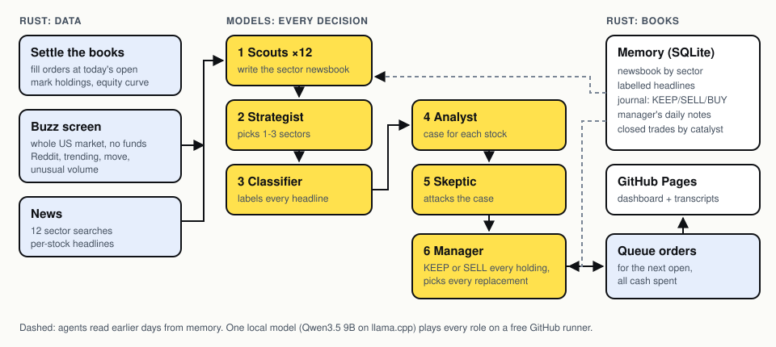

<div align="center">


# Paper Trader

A $1,000 simulated account. Nine local models research US stocks, debate the evidence, and record their decisions on GitHub Pages.

[Dashboard](https://mansoor-mamnoon.github.io/paper-trader/) · [Actions](https://github.com/mansoor-mamnoon/paper-trader/actions) · [Incident audit](docs/AUDIT-2026-11.md)
</div>

## Allocation

The account invests available cash in up to five individual US-listed stocks. Mutual funds, ETFs and index funds are excluded. Model picks receive priority. If they leave slots available, a quantitative momentum ranking supplies eligible stocks. The journal distinguishes those allocations from model recommendations.

At execution, cash is divided among the queued purchases, including fees. Existing stock positions can receive additional cash. Full-investment mode removes the position-size, industry and volatility reductions and the drawdown cash lock. It can put all capital in one stock when only one is eligible.

The account workflow sets `PAPER_TRADER_FULLY_INVESTED=1` and `PAPER_TRADER_UNIVERSE=equities`. Orders execute at the next observed session open. Invalid prices, failed eligibility checks, no eligible stocks or the experiment ending can leave cash temporarily. A rerun cannot backdate purchases. SPY is used only as a performance benchmark and trading-calendar reference.

## Architecture



The Rust program reads daily prices, issuer-matched news, an earnings calendar and optional SEC filings. The screen checks identity, liquidity, corporate events and price history. Research models inspect the survivors. A bull proposes a mechanism; a bear challenges it; the judge compares the candidates. Claim checks reject defined classes of unsupported assertions before orders enter SQLite.

Price spikes alone are technical signals. The model needs a cited company event for a risk-off recommendation. Full-investment mode can allocate by the quantitative ranking when the model abstains. Missing earnings data remains unknown. Model conviction is an uncalibrated score. The November 10 journal contains errors that prompted the [incident repairs](docs/AUDIT-2026-11.md); saved-provider tests cover those examples.

GitHub Actions runs the desk after a completed US session. Orders fill at a later observed session open with a 0.10% fee and 0.20% adverse slippage per side. The `account` branch stores the database and exported dashboard data. GitHub Pages publishes the dashboard. No broker is connected.

## Dashboard tour


The recording uses saved account data. Its journal predates the new allocation policy; the live dashboard shows each run's timestamp. The desk tab contains model arguments, the journal contains decisions and fills, and the strategy lab compares the live account with shadow strategies.

## Run locally

```sh
cargo test --locked
cargo build --release --locked
PAPER_TRADER_FULLY_INVESTED=1 ./target/release/paper-trader stocks --db account.sqlite --output site
```

Set `PAPER_TRADER_LLAMA_SERVER` to the path returned by `scripts/llm.sh install` to enable the model desk. Models download on demand. Set `PAPER_TRADER_SEC_CONTACT` to a contact email to enable SEC requests. Without a model server, the quantitative ranking selects stocks.

To recompute the latest completed session on GitHub:

```sh
gh workflow run account.yml --ref main -f force=true
```

The rerun preserves executed fills and rechecks pending orders. It can return the same stock choices. It cannot replay an arbitrary earlier date against the live account.

## Limits

Daily bars cannot resolve intraday stop fills or live execution quality. News matching and claim checks can miss errors. Model scores have little outcome history, and shadow results share market sessions. The experiment lasts 60 days; its results do not establish a durable trading advantage.
